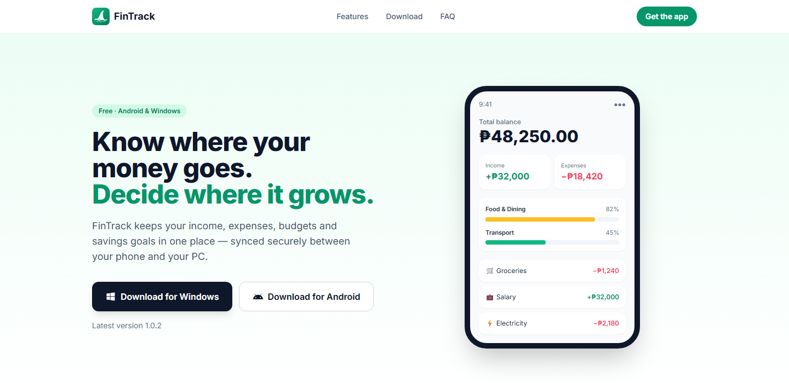

<p align="center">
  
</p>

<h1 align="center">FinTrack</h1>

<p align="center">
  <b>Know where your money goes. Decide where it grows.</b><br>
  A free personal finance and expense tracker for Android and Windows, synced between your phone and your PC.
</p>

<p align="center">
  <a href="https://fintrack-cayena220.vercel.app"></a>
  
  
  
  
</p>

<p align="center">
  <a href="https://fintrack-cayena220.vercel.app/#download"><b>Download</b></a> ·
  <a href="#features">Features</a> ·
  <a href="#how-it-fits-together">How it fits together</a> ·
  <a href="#1-supabase">Set it up</a> ·
  <a href="#3-releasing">Releasing</a>
</p>

<p align="center">
  
</p>

## Features

- **Income and expense tracking**: log transactions and transfers with categories, notes and dates across cash, bank, e-wallet and credit accounts.
- **Budgets and alerts**: set a monthly limit per category and get a notification before you overspend.
- **Reports and charts**: spending by category, monthly trends and income vs. expenses, with CSV export.
- **Savings goals**: save for a laptop, a trip or an emergency fund and watch the progress bar fill.
- **Recurring bills**: rent, subscriptions and salary are recorded automatically on schedule.
- **Offline mode**: add transactions without a connection; they sync when you're back online.
- **Private and synced**: row-level security keeps each account's data to itself, and it stays in sync between phone and PC.

## Project layout

```
app/         Flutter app (one codebase for Android + Windows)
supabase/    Database migrations, pgTAP tests, local config and seed data
website/     Static download page and privacy policy (deployed to Vercel)
installer/   Inno Setup script that turns the Windows build into a setup .exe
scripts/     publish-release.mjs: uploads a build and records it in app_versions
branding/    Logo SVGs and the script that generates every app icon from them
```

## How it fits together

```
 ┌──────────────────────┐        ┌──────────────────────────────────────────┐
 │  FinTrack app        │        │  Supabase (hosted backend)               │
 │  (Flutter)           │        │                                          │
 │                      │  HTTPS │  Auth ......... email sign-up / sign-in  │
 │  • Android  (.apk)   │◄──────►│  Postgres ..... accounts, transactions,  │
 │  • Windows  (.exe)   │        │                 budgets, goals, rules    │
 └──────────────────────┘        │  pg_cron ...... daily recurring-bill job │
                                 │  Storage ...... "releases" bucket with   │
 ┌──────────────────────┐        │                 the APK and installer    │
 │  Website (Vercel)    │  HTTPS │  app_versions . list of published builds │
 │  index.html          │───────►│                                          │
 │  privacy.html        │ (read  └──────────────────────────────────────────┘
 └──────────────────────┘  only)            ▲
                                            │ upload build + insert row
                                 ┌──────────┴───────────┐
                                 │ scripts/             │
                                 │ publish-release.mjs  │  (run on your PC)
                                 └──────────────────────┘
```

- **The app** talks straight to Supabase. There is no custom server: the database enforces who can see what with row-level security (RLS), so each signed-in user can only read and write their own rows.
- **The website** is plain HTML. It reads the `app_versions` table to show the latest download for each platform. That's the only thing its public key is allowed to read.
- **Releases** are files in Supabase Storage. Publishing one adds a row to `app_versions`, which updates both the website and the in-app "Update available" check at once.

## What it's built with

| Piece | Technology | Why |
|---|---|---|
| App UI and logic | [Flutter](https://flutter.dev) (Dart) | One codebase compiles to a native Android app and a native Windows app |
| State management | `flutter_riverpod` | Screens watch "providers" and rebuild when the data changes |
| Navigation | `go_router` | URL-style routes between screens, with sign-in redirects |
| Charts | `fl_chart` | Report and dashboard charts |
| Backend | [Supabase](https://supabase.com) via `supabase_flutter` | Hosted Postgres, auth and file storage with no server code |
| Budget alerts | `flutter_local_notifications` | On-device notifications (Android notifications, Windows toasts) |
| CSV export | `csv` + `file_saver` | Saves report data as a CSV file |
| Email-link sign-in on Windows | `app_links` + `win32_registry` | Registers `io.fintrack.app://` so links from the browser open the app |
| Update check | `package_info_plus` + `url_launcher` | Compares the installed build number with the latest published one |
| Database schema | SQL migrations + pgTAP tests | Version-controlled schema, tested with `supabase test db` |
| Windows installer | [Inno Setup 6](https://jrsoftware.org/isinfo.php) | Packs the build into one `FinTrack-Setup-x.y.z.exe` |
| Website | Static HTML, Tailwind CSS (from a CDN), plain JavaScript | No build step, so the folder is deployed as is |
| Hosting | [Vercel](https://vercel.com) | Serves `website/` as a static site |
| Release upload | Node.js script (`scripts/publish-release.mjs`) | Uploads the build and records the version |
| Icons | Python + Pillow (`branding/make_icons.py`) | Generates every icon size from the logo SVG |

## How each part was built

### The app code (`app/lib/`)

```
main.dart              Starts Supabase, notifications and the Windows link handler
app.dart               The MaterialApp: theme and router
core/                  Shared pieces: env config, router, theme, formatters, common widgets
data/
  models.dart          Plain Dart classes for accounts, transactions, budgets, ...
  repository.dart      Every Supabase query lives here
  offline_store.dart   On-device copies of fetched data and the queue of unsynced transactions
  sync.dart            Uploads the queue when the connection is back; the offline banner's state
  providers.dart       Riverpod providers the screens watch
features/              One folder per screen: auth, dashboard, accounts, transactions,
                       budgets, categories, reports, goals, recurring, settings
services/              Notifications, the update check, the Windows URL scheme
```

Screens never query Supabase directly. They watch a provider, the provider calls the repository, and the repository runs the query. Unit tests in `app/test/` cover budget maths, recurrence dates, formatters, the transaction form, and offline syncing (against a fake Supabase server).

**Offline mode.** Every list the repository fetches is also saved on the device, and is shown instead when there's no connection. Transactions can be added, edited and deleted offline. They're saved to a queue on the device first, with an ID generated on the device, then uploaded right away or as soon as the connection returns. Lists, account balances and category totals include queued changes, and a banner shows "You're offline" or how many changes are waiting. If the server refuses a queued change (for example, its account was deleted on another device), it's dropped and the app says why. Other changes (accounts, budgets, goals, categories) still need a connection.

Settings that differ between environments (Supabase URL, publishable key, feature flags) aren't hard-coded. They come from `app/env.json` and get baked in at build time with `--dart-define-from-file=env.json`. If they're missing, the app shows a "not configured" screen.

### The database (`supabase/migrations/`)

| Migration | What it adds |
|---|---|
| `0001_core_schema.sql` | Tables: profiles, accounts, categories, transactions, budgets, savings goals, goal contributions, recurring rules |
| `0002_rls.sql` | Row-level security: every table is limited to `user_id = auth.uid()` |
| `0003_views.sql` | Views that do the maths in the database: account balances, monthly category totals, goal progress |
| `0004_new_user_trigger.sql` | On sign-up, creates the user's profile and a starter set of categories |
| `0005_recurring_cron.sql` | A daily `pg_cron` job that turns due recurring rules into real transactions |
| `0006_app_versions_and_storage.sql` | The `app_versions` table and the public `releases` storage bucket |

`npx supabase db push` applies these to the hosted project. `supabase/tests/database/fintrack.test.sql` checks the RLS rules and views.

### The Windows app

Building for Windows runs two tools, one after the other.

**1. `flutter build windows --release`** compiles the app:
- Your Dart code is compiled ahead of time into native machine code (`data/app.so`).
- A small C++ program in `app/windows/runner/` hosts the app's window. Visual Studio's C++ compiler builds it through CMake into `fintrack.exe`. That's why Visual Studio with the C++ workload is required.
- The output folder `app/build/windows/x64/runner/Release/` holds `fintrack.exe`, `flutter_windows.dll` (the Flutter engine), one DLL per plugin (notifications, links, file saving, ...) and a `data/` folder with the compiled code and assets. The app needs this whole folder to run, not just the `.exe`.

**2. Inno Setup** (`installer/fintrack.iss`) packs that folder into one setup file:
- It adds the Visual C++ runtime DLLs (`msvcp140.dll`, `vcruntime140*.dll`), so users don't have to install the redistributable separately.
- It installs per user (no admin prompt) under `%LOCALAPPDATA%\Programs\FinTrack`, with Start-menu shortcuts and an uninstaller.
- It registers the `io.fintrack.app://` link scheme, so the "confirm your email" link opens the desktop app. The app also registers the scheme itself at startup (`services/windows_deep_link.dart`), so it works under `flutter run` too.
- It keeps a fixed `AppId`, so a newer installer upgrades the existing install in place.

The result is `installer/Output/FinTrack-Setup-x.y.z.exe`, about 12 MB.

### The Android app

`flutter build apk --release` uses Gradle and the Android SDK to compile the same Dart code into an APK. This machine uses the Android SDK command-line tools and JDK 17, without Android Studio. The APK is signed with the release keystore `app/android/upload-keystore.jks`, whose passwords are in `app/android/key.properties`. Both files are git-ignored. Android only installs an update if it's signed with the same key, so **back both files up**.

The build only includes ARM code (`--target-platform android-arm,android-arm64`), which covers real phones. That keeps the APK around 37 MB, under Supabase's 50 MB upload limit.

`app/android/gradle.properties` limits Gradle to a 2 GB heap, sized for this 7 GB PC. The Flutter template's 8 GB made the build daemon run Windows out of memory, and it left `hs_err_pid*.log` crash files behind. If VS Code's Java extensions are installed, turn off their Gradle import for this folder (`"java.import.gradle.enabled": false` and `"gradle.autoDetect": "off"` in `.vscode/settings.json`). Otherwise they import every plugin's Android project through `app/windows/flutter/ephemeral/.plugin_symlinks` and start one Gradle daemon per Gradle version.

### The website (`website/`)

- `index.html` is the landing page: features, download cards, FAQ. It's styled with Tailwind loaded from a CDN. A small script at the bottom reads `app_versions` from Supabase, fills in the download buttons, sizes and release history, and highlights the right button for the visitor's device.
- `config.js` holds the Supabase URL and the **publishable** key. That key is safe to expose, because RLS only lets it read `app_versions`.
- `privacy.html` is the privacy policy.
- `vercel.json` turns on clean URLs (`/privacy` works) and adds basic security headers.

### Updates

When the app starts, it reads the newest row in `app_versions` for its platform. If that build number is higher than the installed one, it shows **Update available** with the release notes and a download button. That's why every release must bump the build number after the `+` in `pubspec.yaml`.

### The logo and icons

`branding/logo.svg` (the shark fin) is the source. `branding/make_icons.py` takes 1024 px renders of it and writes the Windows `.ico`, the Android launcher icons (including the adaptive-icon layer from `foreground.svg`), the in-app logo and the website icons.

## Prerequisites

| Tool | Needed for |
|---|---|
| Flutter SDK (stable) | Everything in `app/` |
| Android SDK + JDK 17: either Android Studio, or just the SDK command-line tools with `platforms;android-36`, `build-tools;36.0.0` and `ndk;28.2.13676358` (then `flutter config --android-sdk <sdk> --jdk-dir <jdk17>`) | Android builds |
| Visual Studio 2022+ with **Desktop development with C++**, including **C++ CMake tools for Windows** and **C++ ATL** (the notifications plugin needs ATL) | Windows builds |
| Docker Desktop | Running Supabase locally |
| Node 20+ | Supabase CLI (`npx supabase`), Vercel CLI (`npx vercel`) and the publish script |
| Inno Setup 6 | Packaging the Windows installer |

Run `flutter doctor` until the Android toolchain and Visual Studio sections show no issues. Also turn on Windows **Developer Mode** (`start ms-settings:developers`), because Flutter needs it for plugin symlinks. Doctor doesn't check for it.

## 1. Supabase

### Local development

```sh
npx supabase start          # needs Docker
npx supabase db reset       # applies migrations/ and seed.sql
npx supabase test db        # pgTAP tests in supabase/tests/
```

The seed creates a demo user, **demo@fintrack.local** with password **password123**, along with three months of transactions, budgets, goals and recurring rules. Emails sent locally show up in Inbucket at http://localhost:54324.

To try the recurring job by hand, move a rule's `next_run_on` to yesterday in Studio (http://localhost:54323), then run `select public.process_recurring_rules();`.

### Hosted project

1. Create a project at supabase.com, then link and push:
   ```sh
   npx supabase login
   npx supabase link --project-ref YOUR-PROJECT-REF
   npx supabase db push
   ```
2. Go to **Database → Extensions** and check that `pg_cron` is enabled. Migration 0005 schedules the daily job.
3. Go to **Authentication → URL Configuration**. Set **Site URL** to `io.fintrack.app://login-callback`, and add the same value under **Redirect URLs**.
4. (Only if using Google sign-in.) Go to **Authentication → Providers → Google**. Enable it, paste the **Web** client ID and secret (see below), and turn on **Skip nonce check**, which Android native sign-in needs.
5. Go to **Storage → Settings** and raise the upload size limit if your builds are larger than 50 MB.

### Google OAuth clients (Google Cloud Console)

Optional. Google sign-in is currently **off**: the button is hidden unless `ENABLE_GOOGLE_SIGN_IN` is `true` in `env.json`, and the provider is disabled in `supabase/config.toml`. To turn it on, create the clients below, enable the provider, then set the flag.

- **Web application** client: its redirect URI is `https://YOUR-PROJECT-REF.supabase.co/auth/v1/callback`. Its ID goes in Supabase and in `GOOGLE_WEB_CLIENT_ID`.
- **Android** client: package name `io.fintrack.fintrack`, plus the SHA-1 of **both** your debug keystore and your upload keystore:
  ```sh
  keytool -list -v -keystore %USERPROFILE%\.android\debug.keystore -alias androiddebugkey -storepass android
  keytool -list -v -keystore app/android/upload-keystore.jks -alias upload
  ```
- The OAuth consent screen needs a privacy policy URL. Use the deployed `/privacy` page.

## 2. App

```sh
cd app
copy env.example.json env.json      # then fill in the URL and publishable key
flutter pub get
flutter run -d windows --dart-define-from-file=env.json
flutter run -d emulator-5554 --dart-define-from-file=env.json
```

For the local stack, use `http://10.0.2.2:54321` as `SUPABASE_URL` on the Android emulator and `http://127.0.0.1:54321` on Windows. Use the publishable key printed by `npx supabase status`.

Checks:

```sh
flutter analyze
flutter test
```

## 3. Releasing

Bump `version:` in `app/pubspec.yaml` first. Increase the build number after the `+` for every release. Installed apps offer an update only when the published build number is higher than their own.

### Android APK

One-time setup: create an upload keystore and keep it backed up. Losing it means users cannot update to builds signed with a new key.

```sh
keytool -genkey -v -keystore app/android/upload-keystore.jks -keyalg RSA -keysize 2048 -validity 10000 -alias upload
copy app\android\key.properties.example app\android\key.properties   # then fill in the passwords
```

```sh
cd app
flutter build apk --release --target-platform android-arm,android-arm64 --dart-define-from-file=env.json
```

The APK is written to `app/build/app/outputs/flutter-apk/app-release.apk`. Don't use `--split-per-abi`: it adds 1000× the ABI number to the build number Android reports, which breaks the in-app update check. Without `key.properties`, the release build falls back to the debug key. That's fine for local testing, but never publish a debug-signed build.

### Windows installer

```sh
cd app
flutter build windows --release --dart-define-from-file=env.json
cd ..
"%LOCALAPPDATA%\Programs\Inno Setup 6\ISCC.exe" /DAppVersion=1.0.1 installer\fintrack.iss
```

Inno Setup lives under `%LOCALAPPDATA%\Programs\Inno Setup 6` for a per-user install, or `C:\Program Files (x86)\Inno Setup 6` for a system-wide one. The installer is written to `installer/Output/FinTrack-Setup-1.0.1.exe`. Until it's code-signed, SmartScreen shows a warning; choose **More info → Run anyway**.

### Publish

Copy `.env.example` to `.env` (git-ignored) and add the project's **secret** key. The secret key must never go into the app or the website.

```sh
node scripts/publish-release.mjs android --notes "Budgets can now be copied from last month." --dry-run
node scripts/publish-release.mjs android --notes "Budgets can now be copied from last month."
node scripts/publish-release.mjs windows --notes "Budgets can now be copied from last month."
```

The script reads the version from `pubspec.yaml`, uploads the build to the public `releases` bucket and inserts a row into `app_versions`. If a build with the same or a higher number already exists for that platform, it refuses to publish. The website and the in-app update check pick up the new version right away. The website doesn't need redeploying.

## 4. Website (Vercel)

The `website/` folder is linked to the Vercel project **fintrack**. It's a static site with no build command. There's no Git repository connected, so deploys go through the Vercel CLI:

```sh
cd website
npx vercel login                # once per machine
npx vercel deploy               # preview (private: needs your Vercel login to open)
npx vercel deploy --prod        # production (public)
```

Redeploy only when you change files in `website/`. New app releases show up without a redeploy, because the page reads them from Supabase.

To deploy on every push instead, push this repo to GitHub, then connect it in the Vercel dashboard with **Root Directory** set to `website`. A custom domain can be added under **Project → Settings → Domains**.

## Verifying a release end to end

1. Sign up with email, confirm, and sign in on both platforms.
2. Add accounts and transactions, including a transfer, and check that the balances add up.
3. Set a budget and overspend it. A notification should appear at the alert threshold and again past 100%.
4. Check the report charts and export a CSV.
5. Add a goal contribution, then a withdrawal.
6. Create a recurring rule that starts yesterday. Saving it should record the missed transaction.
7. Install from the landing page on a phone, and on a clean Windows machine (Windows Sandbox).
8. Publish a build with a higher build number and check that the older install shows **Update available**.
